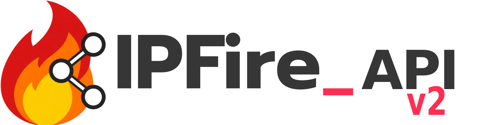

# IPFire-API-v2

A modular, Perl-based API service for IPFire that enables secure remote management and monitoring via WebSocket over TLS.
This version was created using ChatGPT. It is based on my IPFire API.

> **Development status:** Early development. The API is not yet functional.

## Table of Contents

- [Project Goals](#project-goals)
- [Planned Architecture](#planned-architecture)
  - [Module Responsibilities](#module-responsibilities)
- [IPFire Compatibility](#ipfire-compatibility)
  - [Manage client access on IPFire](#manage-client-access-on-ipfire)
  - [Connection and request limits](#connection-and-request-limits)
  - [Configure allowed client networks](#configure-allowed-client-networks)
  - [Use the API management page](#use-the-api-management-page)
  - [Start both services automatically on IPFire](#start-both-services-automatically-on-ipfire)
  - [Test the TLS listener on IPFire](#test-the-tls-listener-on-ipfire)
  - [Send a JSON request](#send-a-json-request)
  - [Subscribe to monitoring events](#subscribe-to-monitoring-events)
  - [Run the Java event client](#run-the-java-event-client)
  - [Test the API on IPFire](#test-the-api-on-ipfire)
- [Development Roadmap](#development-roadmap)
  - [Phase 1 — Project Foundation](#phase-1--project-foundation)
  - [Phase 2 — TLS Server](#phase-2--tls-server)
  - [Phase 3 — WebSocket Protocol](#phase-3--websocket-protocol)
  - [Phase 4 — JSON API Protocol](#phase-4--json-api-protocol)
  - [Phase 5 — Authentication and Security](#phase-5--authentication-and-security)
  - [Phase 6 — Monitoring and Events](#phase-6--monitoring-and-events)
  - [Phase 7 — IPFire Integration](#phase-7--ipfire-integration)
  - [Phase 8 — Future Compatibility](#phase-8--future-compatibility)
- [Development Notes](#development-notes)
- [License](#license)

## Project Goals

The goal is to develop a modular API for IPFire that supports persistent, bidirectional communication between IPFire and external clients.

The implementation should:

- Use Perl and modules already available on IPFire whenever possible.
- Avoid additional runtime dependencies.
- Provide secure WebSocket connections (WSS).
- Support multiple simultaneous clients.
- Use JSON for requests, responses, and events.
- Support monitoring and, eventually, selected management operations.
- Remain independent of the existing IPFire API v1.

Development will proceed incrementally, with testing on a real IPFire installation.

## Planned Architecture

The API will run as a standalone Perl daemon.

The initial communication protocol will be WebSocket over TLS (WSS), using TCP port `8444`.

The planned project structure is:

```text
IPFire-API-v2/
├── bin/
│   ├── ipfire-api-admin.pl
│   ├── ipfire-api-clients.pl
│   └── ipfire-api-daemon.pl
├── cgi-bin/
│   └── api.cgi
├── lib/
│   └── IPFire/
│       └── API/
│           ├── AdminPage.pm
│           ├── AdminProtocol.pm
│           ├── AdminService.pm
│           ├── Auth.pm
│           ├── Client.pm
│           ├── Config.pm
│           ├── NetworkPolicy.pm
│           ├── NetworkSettings.pm
│           ├── Protocol.pm
│           ├── Server.pm
│           ├── System.pm
│           └── WebSocket.pm
├── t/
├── .gitignore
├── LICENSE
└── README.md
```

### Module Responsibilities

| Module | Responsibility |
|---|---|
| `Auth.pm` | Client tokens, authentication and role lookup |
| `AdminPage.pm` | Authenticated WebGUI forms for client and network settings |
| `AdminProtocol.pm` | Local message framing between the CGI and the administration service |
| `AdminService.pm` | Local administration requests and WebGUI process checks |
| `Config.pm` | Server configuration, listening address, port and TLS certificate paths |
| `NetworkPolicy.pm` | Listener address validation and client network checks |
| `NetworkSettings.pm` | Validation and atomic storage of the management page's network settings |
| `Server.pm` | TCP/TLS listener, connection handling and event loop |
| `Client.pm` | Individual client connections and connection state |
| `WebSocket.pm` | WebSocket handshake, frame processing and protocol control |
| `Protocol.pm` | JSON message handling, request dispatching and responses |
| `System.pm` | Read-only system information |
| `ipfire-api-daemon.pl` | Main entry point for the API service |

## IPFire Compatibility

Initial dependency checks were performed on:

- IPFire 2.29 Core Update 205
- Perl 5.42.2

The following modules were confirmed to be available:

| Perl Module | Status |
|---|---|
| `IO::Socket::INET` | Available |
| `IO::Socket::SSL` | Available |
| `Net::SSLeay` | Available |
| `IO::Select` | Available |
| `Digest::SHA` | Available |
| `MIME::Base64` | Available |
| `Protocol::WebSocket` | Not available |

JSON support is already used in the existing API v1 implementation.

The initial assessment suggests that a WebSocket server can be implemented without additional Perl packages. This still requires practical verification.

### Manage client access on IPFire

From the repository checkout, use the same local account that runs the daemon:

```sh
perl bin/ipfire-api-clients.pl add home-assistant
perl bin/ipfire-api-clients.pl list
perl bin/ipfire-api-clients.pl revoke home-assistant
```

`add` creates a client with the `monitoring` role and prints its token once. Store the token in
the client. The client tool stores a SHA-256 digest in the daemon's private client directory. When adding a
client for testing, use a separate name such as `smoke-test`.

Clients send `Authorization: Bearer <token>` with their WebSocket upgrade over TLS. Missing,
invalid and revoked tokens receive HTTP 401. The monitoring role allows `system.ping` and
`system.info`. Revocation applies to subsequent requests on existing connections and to all new
connections. The daemon applies additions and revocations without a restart.

### Connection and request limits

The API daemon accepts up to 32 simultaneous connections across all listeners,
including connections still negotiating TLS or upgrading to WebSocket. Each authenticated token has a
shared allowance across its connections. A client can send a burst of up to
10 requests, and the allowance refills by 2 requests per second. When the
allowance is exhausted, the daemon replies with `rate_limited` for requests
with a valid ID. The WebSocket stays open so the client can retry later.
WebSocket control frames do not consume the request allowance.

### Configure allowed client networks

Without saved settings or an explicit override, the daemon listens on `127.0.0.1`.
For a manual configuration, set
`IPFIRE_API_HOST` to a specific local IPFire address and set `IPFIRE_API_ALLOWED_NETWORKS`
to a comma-separated list of IPv4 or IPv6 client networks in CIDR notation.
For example, replace the documentation addresses below with the IPFire address and the
client network you want to allow:

```sh
IPFIRE_API_HOST=192.0.2.1 IPFIRE_API_ALLOWED_NETWORKS=192.0.2.0/24 \
  perl bin/ipfire-api-daemon.pl
```

The daemon checks the source IP address of each TCP connection before starting TLS.
Clients in allowed networks still need a valid token. An explicit network list replaces
the loopback defaults. Include `127.0.0.0/8` if you use a loopback listener with a custom
list and want local IPv4 clients to connect. The listener accepts a specific IP address.
A non-loopback listener requires an explicit network list. Changes to these
environment variables take effect when the daemon starts.

### Use the API management page

`/cgi-bin/api.cgi` continues to return JSON for HA-IPFire. The response retains the data
HA-IPFire reads, and the existing connect, disconnect, upgrade and reboot requests use their
current API headers. Open **Services → IPFire API v2** in the authenticated IPFire WebGUI
to manage API v2 clients and allowed networks. The direct address is
`/cgi-bin/api.cgi?view=admin`. Copy a new client's token when the page displays it.

Install the menu entry from the project checkout as root:

```sh
install -o root -g root -m 0644 deploy/ipfire/EX-ipfire-api-v2.menu /var/ipfire/menu.d/EX-ipfire-api-v2.menu
```

Install the init script and boot links below to use the **API daemon** controls.
**Start** and **Stop** change the current runtime state. **Start at system boot**
controls the next boot independently. The administration service stays running
so you can start the API or edit its settings while it is stopped.

On a test IPFire, install the Perl modules so `/usr/local/lib/ipfire-api-v2/IPFire/API/AdminPage.pm`
exists. Back up any existing `/srv/web/ipfire/cgi-bin/api.cgi` before installing the new CGI there
with mode `0755`. Start the local administration service from the project checkout, using the
Apache user from `/etc/httpd/conf/uid.conf` as its argument:

```sh
perl bin/ipfire-api-admin.pl nobody
```

Run the administration service and the TLS daemon as the same local account. The administration
service checks the Unix socket peer against the specified WebGUI user and uses the same private
client directory as the daemon. Keep the administration service running while using the page.

Under **Network access**, select the zones under **Allowed networks**. GREEN is
preselected for a fresh setup. ORANGE and BLUE are offered when configured.
Each selected zone enables a listener on that IPFire interface address. The
listener accepts connections from that zone's configured IPv4 subnet. Both the
address and the subnet are shown beside the checkbox.

Saving writes the zone selection to `/var/ipfire/api-v2-network.json`. A running API daemon
automatically reloads its listeners within about one second. Active WebSocket connections
close when the listener configuration changes, so clients can reconnect. If a new
listener cannot be opened, the daemon logs the error, keeps its previous listeners
and retries automatically. IPFire firewall rules still apply and may require access to the API
port on the zone's own IPFire address. The WebGUI handles its own access.
A change through the WebGUI replaces any previously saved manual listener and CIDRs.
Setting `IPFIRE_API_HOST` or `IPFIRE_API_ALLOWED_NETWORKS` selects the manual
single-listener mode for that process and disables automatic reloads.

### Start both services automatically on IPFire

The SysV init script starts the API daemon and the local administration service
from `/root/IPFire-API-v2`. It reads the Apache user from
`/etc/httpd/conf/uid.conf` and uses the project's default configuration paths.
Stop any manually started instances with Ctrl+C in their original terminals
before switching to the init script.

Install and start the script as root on IPFire:

```sh
cd /root/IPFire-API-v2 &&
install -o root -g root -m 0755 deploy/ipfire/ipfire-api-v2 /etc/rc.d/init.d/ipfire-api-v2 &&
/etc/rc.d/init.d/ipfire-api-v2 start &&
/etc/rc.d/init.d/ipfire-api-v2 status
```

Once both processes are running, enable startup after the network is configured
and stop the services on shutdown or reboot:

```sh
ln -s ../init.d/ipfire-api-v2 /etc/rc.d/rc3.d/S99ipfire-api-v2 &&
ln -s ../init.d/ipfire-api-v2 /etc/rc.d/rc0.d/K20ipfire-api-v2 &&
ln -s ../init.d/ipfire-api-v2 /etc/rc.d/rc6.d/K20ipfire-api-v2
```

The boot links start the administration service and honor the API daemon's
autostart setting. The API autostart is enabled by default. Disabling it creates
`/etc/sysconfig/ipfire-api-v2.no-autostart`.

Use `/etc/rc.d/init.d/ipfire-api-v2 stop`, `restart` or `status` to manage
the processes together. A combined restart honors the autostart setting. Use
`daemon-start` or `daemon-stop` to explicitly control only the API daemon.
Look for `ipfire-api-admin` and `ipfire-api-daemon` in the
IPFire system log. After the next IPFire reboot, check `status`, confirm the
expected listener with `ss -ltnp 'sport = :8444'` and open the management page
to confirm it can reach the administration service.

### Test the TLS listener on IPFire

The API requires TLS 1.2 or newer. It uses the IPFire WebGUI certificate and
private key by default. Clients must verify the certificate against a trusted CA
and check the name they expect to connect to. For a self-signed IPFire certificate,
use a trusted copy of the public certificate as the CA file. Keep the private
key on IPFire and restrict read access to the services that need it. Restart the
daemon after replacing its certificate or key.

For a local test from the repository checkout on IPFire, start the daemon with explicit loopback settings:

```sh
IPFIRE_API_HOST=127.0.0.1 IPFIRE_API_ALLOWED_NETWORKS=127.0.0.0/8 perl bin/ipfire-api-daemon.pl
```

From a second shell on the same IPFire host, connect to the listener:

```sh
openssl s_client -connect 127.0.0.1:8444 \
  -servername ipfire.local -verify_hostname ipfire.local \
  -CAfile /etc/httpd/server.crt -verify_return_error </dev/null
```

Use your IPFire certificate name in place of `ipfire.local`.
The daemon allows up to five seconds for the TLS handshake and another five seconds for the WebSocket upgrade.
Stop it with `Ctrl+C` or send `SIGTERM` to the daemon process. The daemon closes its listener and
client connections, prints `IPFire API v2 stopped`, and exits successfully.
If the server certificate was issued by a CA, use that CA's certificate for `-CAfile`.

API v2 service logs record lifecycle events, timeouts and general failure
messages. They omit bearer tokens, token digests and raw client requests.

To check the handshake timeout, open a TCP connection without starting TLS from the second shell on IPFire:

```sh
time timeout 8 bash -c 'exec 3<>/dev/tcp/127.0.0.1/8444; cat <&3'
```

Expect the connection to close after about five seconds and the daemon to log `TLS handshake failed: timed out`.
Run the [API smoke test](#test-the-api-on-ipfire) immediately afterward to confirm that the daemon serves another client.

To test the WebSocket upgrade from the second shell, run:

```sh
key=$(openssl rand -base64 16)
read -rs -p 'Client token: ' token
printf '\n'
printf 'GET / HTTP/1.1\r\nHost: 127.0.0.1:8444\r\nUpgrade: websocket\r\nConnection: Upgrade\r\nSec-WebSocket-Version: 13\r\nSec-WebSocket-Key: %s\r\nAuthorization: Bearer %s\r\n\r\n' "$key" "$token" |
  openssl s_client -quiet -connect 127.0.0.1:8444 \
    -CAfile /etc/httpd/server.crt -verify_return_error
unset token
```

Expect `HTTP/1.1 101 Switching Protocols` and a `Sec-WebSocket-Accept` header.
The daemon keeps the connection open after the upgrade and waits up to 30 seconds for each frame.
It allows up to five seconds to send each reply frame and closes connections that time out.
See [Connection and request limits](#connection-and-request-limits) for the limits that apply to this connection.
The message limit is 64 KiB, including fragmented messages.
Ping receives Pong, and Close ends the connection.

### Send a JSON request

Send one JSON object per WebSocket text message. Each request has an `id` string of 1 to 128 characters
and a `method` string. The first method, `system.ping`, accepts no parameters. The `params` field can
be omitted or set to an empty object.

```json
{"id":"ping-1","method":"system.ping"}
```

The reply carries the same ID and a `result` or `error` object. For example:

```json
{"id":"ping-1","result":{"pong":true}}
```

Errors contain `code` and `message`. The reply ID is `null` when the request has no valid ID.
The current error codes are `invalid_json`, `invalid_request`, `method_not_found`, `invalid_params`,
`access_denied`, `rate_limited` and `internal_error`. If a method fails internally,
the response carries the request ID and the client can continue using the same connection.

Use `{"id":"info-1","method":"system.info"}` for the hostname, the IPFire release string and whole
seconds since boot. The result fields are `hostname`, `ipfire_release` and `uptime_seconds`.
Release and uptime are `null` if their sources are unavailable. This method also accepts no parameters.

### Subscribe to monitoring events

An authenticated monitoring client can subscribe on its WebSocket connection.

```json
{"id":"watch-1","method":"events.subscribe","params":{"event":"system.info"}}
```

The reply is `{"id":"watch-1","result":{"event":"system.info","subscribed":true}}`.
The daemon then sends a notification approximately every five seconds when the
connection can send it. A notification carries an event name and data, with no
request ID. The data has the same fields as the `system.info` method.

```json
{"event":"system.info","data":{"hostname":"ipfire","ipfire_release":"IPFire","uptime_seconds":3600}}
```

Subscribe to `red.status` to monitor the RED interface:

```json
{"id":"watch-red","method":"events.subscribe","params":{"event":"red.status"}}
```

The daemon sends the current RED status after confirming the subscription. It
then checks approximately every five seconds and sends an event when the
status or connection timestamp changes.

```json
{"event":"red.status","data":{"status":"connected","connected_since":1795383000}}
```

The status is `connected` while IPFire's `/var/ipfire/red/active` marker exists,
`disconnected` when the marker is absent and the RED directory is available,
or `unknown` when the RED state cannot be read. `connected_since` is the
marker's modification time in Unix seconds. It is `null` in the other states.
This reports IPFire's RED state. Internet reachability is a separate check.

Call `events.unsubscribe` with the same `params` to stop notifications.
Each event can be subscribed to and unsubscribed from independently.
Repeated subscribe and unsubscribe requests are safe. Each subscription belongs
to its connection. A client must subscribe again after reconnecting. The daemon
checks the client token before queuing each notification.

### Run the Java event client

A simple graphical Java client is available for testing IPFire API v2. It
connects over WSS, subscribes to `system.info` and `red.status` and displays the
subscription replies and JSON notifications. It uses only the Java standard library.
Download the [example JAR](examples/java/ipfire-events.jar) and run it on Java
11 or later with `java -jar ipfire-events.jar`. To build the client from source,
use a JDK:

```sh
cd examples/java
javac -encoding UTF-8 --release 11 -d build/classes IPFireEvents.java IPFireEventsWindow.java
jar --create --file build/ipfire-events.jar --main-class IPFireEvents -C build/classes .
```

Open the graphical client from a desktop session:

```sh
java -jar build/ipfire-events.jar
```

Enter the WebSocket URL, for example `wss://ipfire.local:8444/`, and paste the
token into the masked token field. If IPFire uses a self-signed certificate,
select a trusted copy of its public certificate in the certificate field.
The certificate dialog shows PEM files by default. Choose **All files** to
select a certificate with a different extension.

Use the radio buttons above the output to select **System**, **RED-Status** or
**Alle verfügbaren** before connecting. Other API v1 topics are shown as
disabled until API v2 supports them. Use **Verbinden** to start receiving
JSON messages and **Trennen** to end the session.

If the connection drops after a successful connection, the graphical client
retries with an increasing delay of up to 30 seconds and restores the selected
subscriptions. **Trennen** cancels retries. A rejected token or a certificate
error stops the retry cycle so the connection settings can be corrected.

Passing the URL when launching the JAR selects the command-line mode:

```sh
java -jar build/ipfire-events.jar wss://ipfire.local:8444/ ipfire-public.pem
```

Use a trusted copy of the public server certificate for a self-signed IPFire
certificate, or pass the issuing CA certificate in PEM format. Omit the second
argument to use Java's default trust store. Java verifies the server name in
either case. Enter the client token when prompted. The client also accepts the
token on standard input for non-interactive use. Press Ctrl+C to close the client.

### Test the API on IPFire

Start the daemon with the loopback test settings above in the first SSH session. In a second Bash session on IPFire, run
this from the repository checkout and enter a valid client token:

```sh
read -rs -p 'Client token: ' token
printf '\n'
printf '%s\n' "$token" | perl -Ilib t/ipfire-smoke.pl ipfire.local
unset token
```

Replace `ipfire.local` with the name on your IPFire certificate.
To test the running service on GREEN, pass its listener IP as the second argument,
for example `perl -Ilib t/ipfire-smoke.pl ipfire.local 192.168.0.254`.
If a CA issued the certificate, pass the CA certificate path as the third argument.
Expect the verified TLS version, `Upgrade OK`, `Pong OK`, `system.ping OK`, the system information in JSON,
`system.info OK` and `Close OK`.

On IPFire, run the concurrency test from the repository with `perl -Ilib t/server-concurrency.t`.
It starts its own daemon on a free loopback port and uses a temporary certificate generated with
OpenSSL. It checks that an unfinished TLS handshake and a partial WebSocket frame leave other
clients able to get a response. It also checks shutdown with `SIGTERM` and reuse of the listening
port, rejects missing and invalid tokens, verifies live revocation, and checks that
two configured zone listeners share the same port with separate source networks.
It also checks TLS versions, certificate trust, hostname verification and the
absence of credentials in the daemon log.

Run the full test suite on development systems with `prove -l t`.

| Environment variable | Default |
|---|---|
| `IPFIRE_API_HOST` | `127.0.0.1` |
| `IPFIRE_API_ALLOWED_NETWORKS` | `127.0.0.0/8,::1/128` for loopback listeners |
| `IPFIRE_API_PORT` | `8444` |
| `IPFIRE_API_CERT_FILE` | `/etc/httpd/server.crt` |
| `IPFIRE_API_KEY_FILE` | `/etc/httpd/server.key` |
| `IPFIRE_API_CLIENT_DIR` | `/var/ipfire/api-v2-clients` |
| `IPFIRE_API_NETWORK_SETTINGS_FILE` | `/var/ipfire/api-v2-network.json` |
| `IPFIRE_API_ADMIN_SOCKET` | `/run/ipfire-api-v2-admin/control.sock` |

## Development Roadmap

### Phase 1 — Project Foundation

- [x] Create the GitHub repository.
- [x] Create the `develop` branch.
- [x] Define the initial architecture.
- [x] Create the project directory structure.
- [x] Check Perl and TLS dependencies on IPFire Core 205.
- [x] Create the initial `Config.pm` module.
- [x] Create the initial `Server.pm` skeleton.
- [x] Implement `ipfire-api-daemon.pl`.
- [x] Verify Perl syntax and module loading.
- [x] Confirm usable TLS certificate and private key paths.
- [x] Implement configurable listening address and port.

### Phase 2 — TLS Server

- [x] Implement the TLS listener.
- [x] Accept incoming client connections.
- [x] Implement connection timeouts and error handling.
- [x] Verify TLS handshake timeout and successful handling of the next client on IPFire Core Update 205.
- [x] Use non-blocking TLS operations with `IO::Select`.
- [x] Support multiple simultaneous clients and verify them over TLS on Linux loopback.
- [x] Verify multiple simultaneous clients on IPFire Core Update 205.
- [x] Implement clean startup and shutdown.
- [x] Verify startup, SIGTERM shutdown, client disconnect and port reuse on IPFire Core Update 205.
- [x] Verify a TLS 1.3 handshake on IPFire over loopback.

### Phase 3 — WebSocket Protocol

- [x] Implement the HTTP WebSocket upgrade handshake.
- [x] Validate the `Sec-WebSocket-Key` header.
- [x] Generate the `Sec-WebSocket-Accept` response.
- [x] Verify the HTTP upgrade over TLS on IPFire.
- [x] Parse client frames and encode server control frames.
- [x] Support client masking and fragmented messages.
- [x] Implement Ping/Pong frames.
- [x] Implement Close frames and connection cleanup.
- [x] Enforce message size limits and protocol validation.
- [x] Verify Ping/Pong and Close over TLS on IPFire.
- [x] Verify the WebSocket connection and both JSON methods with `wscat` on Debian 13 over local TLS.

### Phase 4 — JSON API Protocol

- [x] Define a consistent JSON message format.
- [x] Implement request and response identifiers.
- [x] Implement structured error responses.
- [x] Add a basic `system.ping` request.
- [x] Verify `system.ping` and its response ID over TLS on IPFire.
- [x] Add an initial read-only `system.info` request.
- [x] Verify `system.info` over TLS on IPFire Core Update 205.
- [x] Dispatch requests by method name.
- [x] Add automated protocol tests.

### Phase 5 — Authentication and Security

- [x] Require an individual bearer token for each client.
- [x] Define a read-only monitoring role and check its permissions for each request.
- [x] Add local commands to create, list and revoke client access.
- [x] Verify client authentication and revocation on IPFire Core Update 205.
- [x] Restrict the listener to a specific address and apply a client network allowlist before TLS.
- [x] Verify on IPFire Core Update 205 that the allowlist admits an approved loopback address and closes an unlisted connection before TLS.
- [x] Limit simultaneous connections and rate-limit API requests per authenticated client across all its connections.
- [x] Verify on IPFire Core Update 205 that connections using the same token share the request limit, other tokens remain unaffected and requests succeed again after refill.
- [x] Review API v2 input validation and error handling. Test malformed upgrades, method failures and network form validation.
- [x] Verify on IPFire Core Update 205 that the management page saves the GREEN selection and the API continues to listen on the GREEN address.
- [x] Review API v2 logging and verify that daemon logs omit tokens and token digests.
- [x] Require TLS 1.2 or newer and test certificate trust and hostname verification.
- [x] Verify on IPFire Core Update 205 that TLS 1.2 and 1.3 work, TLS 1.1 is rejected, the client rejects untrusted or mismatched test certificates, and the daemon log omits test tokens and their digests.

### Phase 6 — Monitoring and Events

- [x] Implement client subscriptions to `system.info`.
- [x] Define event message formats.
- [x] Implement server-initiated notifications.
- [x] Verify on IPFire that a subscriber receives `system.info` and stops receiving events after unsubscribe.
- [x] Verify that the graphical Java client subscribes to `system.info` over WSS and displays periodic events from IPFire Core Update 205.
- [x] Add RED interface status notifications with an initial snapshot and change detection.
- [x] Verify the initial RED status and simulated status changes on IPFire.
- [x] Clear subscriptions when their WebSocket connection closes.
- [x] Verify on IPFire that the Java GUI reconnects and restores the selected subscriptions.
- [x] Verify the PEM file filter in the Java GUI certificate dialog.
- [ ] Evaluate MQTT as a possible future event interface.

### Phase 7 — IPFire Integration

#### 7.1 Define the API v2 feature scope

- [ ] Inventory the read-only functions and management operations available through API v1 (`api.cgi`) and identify the consumers that use them.
- [ ] Decide which v1 functions are required in v2, which can follow later, and which need a replacement. Record the v2 method or event, required permission and acceptance test for each feature.
- [ ] Prioritize new v2 capabilities separately, using client needs and community feedback to define the scope of each release.

#### 7.2 Migrate API v1 monitoring to v2

- [ ] Identify reusable IPFire system interfaces and functions.
- [ ] Implement the required read-only v2 methods and events for system information, RED connection status, traffic, network, DHCP leases, services, add-ons and update status. Build on the existing `system.info` and `red.status` events.
- [ ] Compare the v2 data with API v1 on IPFire and verify that it covers the agreed monitoring scope and the data HA-IPFire needs.

#### 7.3 Extend user and client access management

- [ ] Define which permissions users and API clients need for monitoring and management, starting from the existing read-only monitoring role.
- [ ] Extend the management page to assign roles and manage client credentials, including token rotation and revocation.
- [ ] Test that each role can perform its permitted operations and is denied the others. Verify that existing monitoring clients retain their read-only access.

#### 7.4 Migrate approved API v1 management operations

- [ ] Decide the v2 treatment of the four v1 operations: connect RED, disconnect RED, upgrade IPFire and reboot IPFire.
- [ ] After the permission model is in place, implement the operations approved in the feature scope. Define validation, permission checks, and how clients get confirmation or failure status.
- [ ] Verify the approved operations on IPFire before enabling them for clients.

#### 7.5 Install and operate API v2 on IPFire

- [x] Add a SysV init script and document boot and shutdown integration.
- [x] Verify that both services start after reboot on IPFire Core Update 205, the API listens on the saved GREEN address and the management page reaches the administration service.
- [x] Add an API v2 management interface in `api.cgi` for client access and allowed networks.
- [x] Add a Services menu entry and separate API daemon runtime and autostart controls.
- [x] Verify that the management page loads in the native IPFire WebGUI.
- [x] Verify that HA-IPFire still receives the monitoring data it needs from `api.cgi`.
- [x] Verify that creating a client in the IPFire WebGUI displays its token.
- [x] Verify that deleting a client through the IPFire WebGUI removes it from the client list.
- [x] Verify automatic application of network settings saved through the WebGUI on IPFire.
- [ ] Document installation and configuration.

### Phase 8 — Future Compatibility

- [ ] Verify with HA-IPFire that the migrated API v2 monitoring functions cover the required data.
- [ ] Add connection checks and fallbacks to HA-IPFire in the order below.
- [ ] Expand the API based on testing and community feedback.

| Priority | Interface | When HA-IPFire uses it |
|---|---|---|
| Primary | API v2 | When HA-IPFire can connect to API v2 and use it for monitoring |
| First fallback | `api.cgi` | When API v2 is unavailable or unusable and `api.cgi` works |
| Second fallback | `speed.cgi` | When neither API v2 nor `api.cgi` is usable. This provides basic RED interface traffic monitoring. |

## Development Notes

API v2 is intended to become the primary interface for HA-IPFire and other clients once it provides
the required monitoring capabilities. `api.cgi` remains a compatibility fallback for existing
installations and receives necessary maintenance and bug fixes.

The API v2 is being developed incrementally. Features, interfaces and implementation details may change during development.

The first milestone is a minimal, TLS-protected WebSocket server capable of accepting a connection and responding to a simple JSON request.

## License

GPL-3.0
